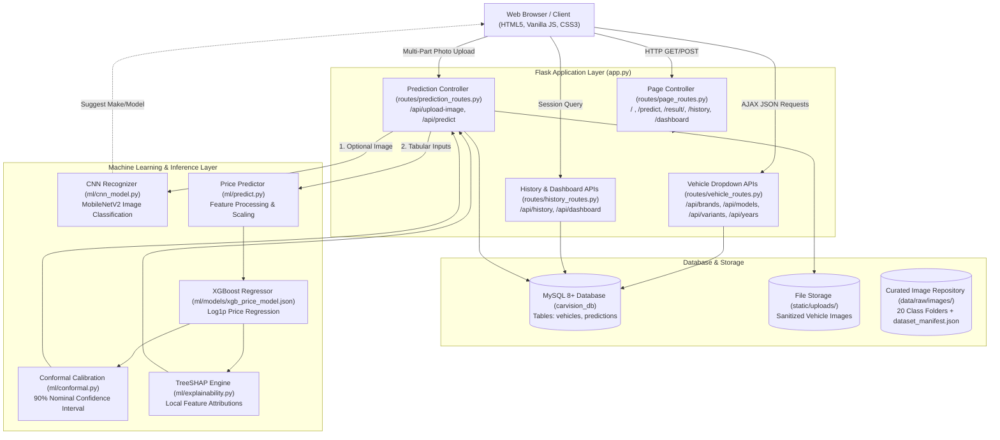

# CarVision — AI-Based Vehicle Resale Price Prediction Using CNN and XGBoost
# CarVision — Intelligent Vehicle Resale Price Prediction & Image Recognition System

Upload a car photo → pick Brand → Model → Variant → Year → enter a few details → get an estimated
resale value, a statistically calibrated price range, and the factors that influenced it.
[](https://www.python.org/)
[](https://flask.palletsprojects.com/)
[](https://xgboost.readthedocs.io/)
[](https://www.tensorflow.org/)
[](https://www.mysql.com/)
[](LICENSE)
[](#testing-and-verification)

**No vehicle data, model metric, price or accuracy figure is bundled with this project.** Every dropdown
value comes from the MySQL database you fill from *your* CSV; every number shown to a user comes from
a model *you* train on that data.
CarVision is an advanced, production-ready AI platform designed to determine used vehicle valuation through a decoupled **Dual-AI architecture**:

1. **Tabular Valuation Regressor (XGBoost):** An Extreme Gradient Boosting engine trained on $15,000$ vehicle records that predicts fair resale market value, generates statistically calibrated prediction intervals ($\sim 90\%$ coverage) via split-conformal inference, and explains individual pricing decisions using TreeSHAP feature attributions.
2. **Visual Make/Model Assistant (MobileNetV2):** A deep transfer-learning convolutional neural network designed to identify vehicle manufacturer and model from user-uploaded exterior photographs, pre-populating the evaluation workflow.

---
## 1. What is finished, and what needs your data

| Part | Status |
|---|---|
| Flask app, MySQL schema, dynamic APIs, 4-step UI, history, dashboard, validation, error handling | **Done** (smoke-tested without a DB) |
| CSV inspection, cleaning, DB import (adapts to the columns your CSV really has) | **Done — needs your CSV** |
| Feature engineering, XGBoost training, conformal price range, evaluation, SHAP-style explanation | **Done — needs your CSV, `xgboost`** |
| CNN transfer-learning training + recognition in the upload step | **Done — optional; needs images, `tensorflow`** |
## Table of Contents

Until data is imported the UI shows "Vehicle data has not been loaded yet"; until the model is trained
the UI says estimates are unavailable. It never shows placeholder values.
- [Project Overview](#project-overview)
- [Key Features](#key-features)
- [System Architecture](#system-architecture)
- [Machine Learning & Deep Learning Pipeline](#machine-learning--deep-learning-pipeline)
  - [1. XGBoost Resale Price Regressor](#1-xgboost-resale-price-regressor)
  - [2. Split-Conformal Prediction Uncertainty](#2-split-conformal-prediction-uncertainty)
  - [3. TreeSHAP Explainability](#3-treeshap-explainability)
  - [4. MobileNetV2 Vision Assistant & Fallback](#4-mobilenetv2-vision-assistant--fallback)
- [Technology Stack](#technology-stack)
- [Repository Structure](#repository-structure)
- [Installation and Setup](#installation-and-setup)
- [Environment Configuration](#environment-configuration)
- [Datasets and Artifacts](#datasets-and-artifacts)
- [Testing and Verification](#testing-and-verification)
- [Current Development Status](#current-development-status)
- [Future Enhancements](#future-enhancements)
- [Academic & Author Information](#academic--author-information)

## 2. Architecture
---

```
Car Image ─► CNN (MobileNetV2, transfer learning) ─► brand/model suggestion (optional, user can override)
## Project Overview

Vehicle details ─► cleaning ─► feature engineering ─► XGBoost (log-price) ─► estimate
                                                          └► split-conformal calibration ─► price range
                                                          └► gain importance + tree-SHAP ─► explanation
Traditional online car valuation tools rely on static heuristics or opaque rules that fail to capture nonlinear feature interactions, market depreciation, and prediction uncertainty. CarVision resolves these limitations by decoupling visual recognition from price regression:

* **Visual Recognition (Make & Model):** The CNN focuses exclusively on macroscopic exterior visual features (grille shape, lighting signatures, body silhouettes) to infer the vehicle's Make and Model. The CNN output is **never** fed directly into the pricing model as an unverified numerical feature.
* **Valuation Regression (Structured Attributes):** The resale price is estimated strictly by the XGBoost tabular model using verified specifications (model year, mileage, fuel type, transmission, engine displacement, ownership history, vehicle condition, and geographical registration).
* **Guaranteed Reliability:** If a photo is unclear, unlisted, or the CNN model weights are offline, the application seamlessly falls back to a 4-step manual selection wizard without failing or degrading the financial valuation.

---

## Key Features

### Fully Operational Features
* **AI-Powered Resale Price Prediction:** High-accuracy valuation based on gradient-boosted decision trees ($R^2 = 0.985$, $\text{MAPE} = 5.22\%$).
* **Cascading Vehicle Selection:** Dynamic hierarchical dependency filtering ($\text{Brand} \to \text{Model} \to \text{Variant} \to \text{Year}$) backed by database-indexed SQL queries.
* **Statistically Calibrated Price Intervals:** Split-conformal prediction intervals with verified nominal $90\%$ coverage on unseen test sets ($89.64\%$ empirical coverage).
* **Transparent TreeSHAP Explainability:** Local feature attribution breakdowns showing how mileage, age, brand, and vehicle condition impact the valuation above or below baseline market averages.
* **Market Depreciation Benchmarking:** Compares predicted resale value against original manufacturer ex-showroom benchmark listings where reference data exists.
* **Session-Isolated Prediction History:** Private, anonymous user session history allowing visitors to review past valuations, inspect full parameters, and delete records without requiring account registration.
* **Interactive Analytics Dashboard:** Real-time summary statistics, average market valuation, brand frequency distributions, and model performance metrics.
* **Automated Data Processing Pipeline:** Heuristic column mapping, parsing of multi-unit numerical values (e.g. "Lakh", "Crore", "km/l"), and robust cleaning.
* **Secure Image Processing:** Multi-part file upload with EXIF metadata stripping, dimension bounds checking, and randomized UUID storage.

### In-Progress & Baseline Modules
* **MobileNetV2 Vision Assistant:** Complete inference wrapper and two-phase transfer-learning training pipeline implemented. Initial open-license dataset curated ($338$ verified unique images across 19 classes with full manifest provenance). Final model training and weight generation are pending dataset expansion.
* **Manual Fallback Integration:** If the CNN is dormant, the web application detects its unavailability via runtime guards and guides the user directly to manual vehicle entry without throwing errors.

---

## System Architecture



**Image vs. price (important for your viva).** Public image datasets and price datasets are almost never
paired row-by-row, so the CNN's output is **not** a price feature (`IMAGE_FEATURES_IN_PRICE_MODEL = False`
in `ml/config.py`; the UI text reads that flag). The CNN only recognises what its labels cover, and a
suggestion is offered only if confidence ≥ `CNN_CONFIDENCE_THRESHOLD` **and** the label matches a
brand+model in your database. If your CSV *does* link each row to a photo, tell me and I'll add an image-feature
branch and a with/without-image ablation so any improvement is measured, not claimed.
---

**Price range.** Split conformal prediction: residuals on `log1p(price)` from a held-out calibration set →
`q` = ⌈(n+1)(1−α)⌉-th smallest residual → interval `expm1(ŷ ± q)`. Default α = 0.10 (90 %). Actual coverage
on the untouched test set is measured and reported (`interval_coverage` in `ml/models/metrics.json`).
Limitation: constant *relative* width for every car.
## Machine Learning & Deep Learning Pipeline

**Engineered features** (`ml/feature_processing.py`): `vehicle_age` (newest training year − year) and
`km_per_year` (km ÷ max(age,1)). Neither uses the target, so there is no leakage. Fields are used by the model
only if ≥ 80 % filled and non-constant; the UI asks **only** for fields the trained model uses.
### 1. XGBoost Resale Price Regressor
* **Objective:** Predict used vehicle market resale value (`selling_price`).
* **Target Transformation:** $\log(1 + y)$ transformation (`log1p`) to normalize right-skewed automotive prices and minimize relative percentage error.
* **Engineered Features:**
  * `vehicle_age`: Reference year ($2025$) minus vehicle manufacturing year.
  * `km_per_year`: Odometer reading divided by $\max(\text{vehicle\_age}, 1)$.
* **Categorical Encoders:** Robust target-aligned frequency and ordinal encoders for high-cardinality fields (`brand`, `model`, `variant`, `location`, `fuel_type`, `transmission`, `vehicle_condition`).
* **Training Partitions ($15,000$ Listings):**
  * **Train Set:** $8,999$ records ($60\%$)
  * **Validation Set:** $1,501$ records ($10\%$)
  * **Calibration Set:** $2,250$ records ($15\%$)
  * **Test Set:** $2,250$ records ($15\%$)
* **Verified Performance Metrics (Held-out Test Set):**
  * **Coefficient of Determination ($R^2$):** $0.985$ ($98.5\%$)
  * **Mean Absolute Error (MAE):** ₹$46,274.58$
  * **Root Mean Squared Error (RMSE):** ₹$109,803.54$
  * **Mean Absolute Percentage Error (MAPE):** $5.22\%$
  * **Median Absolute Error:** ₹$22,461.22$

**Depreciation** is shown only if your CSV has an original/new/ex-showroom price column (`original_price`),
with ≥ 3 matching listings; otherwise it is simply not displayed.
### 2. Split-Conformal Prediction Uncertainty
Rather than outputting a single point estimate, CarVision computes non-parametric prediction intervals $[L, U]$ using split-conformal calibration:
* Residuals are calculated on the log scale over the $2,250$ calibration samples:
  $$r_i = |\log(1 + y_i) - \log(1 + \hat{y}_i)|$$
* For a nominal confidence level $1 - \alpha = 0.90$ ($\alpha = 0.10$), the conformal quantile is:
  $$\hat{q} = \text{Quantile}\left(r, \frac{\lceil(n+1)(1-\alpha)\rceil}{n}\right) = 0.108787$$
* The calibrated price interval is transformed back to currency units:
  $$[\exp(\log(1 + \hat{y}) - \hat{q}) - 1, \; \exp(\log(1 + \hat{y}) + \hat{q}) - 1]$$
* **Verified Test Coverage:** Achieves **$89.64\%$** empirical coverage on the untouched test partition with a median interval width of ₹$138,344.28$.

## 3. Project structure
### 3. TreeSHAP Explainability
* Evaluates exact game-theoretic Shapley values using TreeSHAP algorithms.
* Decomposes the difference between the model's expected base value and the vehicle's specific prediction into positive (price-increasing) and negative (price-depreciating) contributions.
* Informs users whether high mileage, advanced vehicle age, or brand prestige drove the appraisal outcome.

### 4. MobileNetV2 Vision Assistant & Fallback
* **Architecture:** MobileNetV2 pretrained on ImageNet ($3.5\text{M}$ parameters) coupled with:
  * In-graph spatial augmentations (`RandomFlip`, `RandomRotation(0.05)`, `RandomZoom(0.1)`).
  * In-graph rescaling layer `Rescaling(1/127.5, offset=-1)`.
  * `GlobalAveragePooling2D` $\to$ `Dropout(0.3)` $\to$ `Dense(n_classes, activation="softmax")`.
* **Two-Phase Transfer Schedule:**
  * *Phase 1:* Base frozen, classification head trained with Adam ($\eta = 10^{-3}$).
  * *Phase 2:* Top 40 layers unfrozen, `BatchNormalization` layers explicitly frozen, Adam ($\eta = 10^{-5}$).
* **Scope & Boundary:** Operates exclusively at the **Make & Model** level. Vehicle trim variants (e.g. Swift VXi vs. ZXi) share identical exterior body shells and are selected manually in Step 2 to eliminate visual ambiguity.
* **Inference Guard:** [`CnnRecognizer.is_available()`](ml/cnn_model.py) verifies the existence of model weights before loading. If unavailable, `detection=None` is returned, and the frontend wizard advances seamlessly to manual input.

---

## Technology Stack

| Category | Technology / Library | Verified Version | Purpose |
| :--- | :--- | :--- | :--- |
| **Language** | Python | `3.11.9` | Primary backend and machine learning runtime |
| **Web Framework** | Flask | `3.1.3` | Application factory, routing, context processors, error handling |
| **WSGI / Web Utils** | Werkzeug | `3.1.9` | Request routing, multipart upload handling, security filters |
| **Database** | MySQL / MariaDB | `8.0+` | Relational storage for vehicle catalog and prediction logs |
| **DB Driver** | PyMySQL | `1.2.3` | Pure-Python MySQL client connection pool |
| **DB Auth** | cryptography | `50.0.2` | Authentication support for MySQL 8 `caching_sha2_password` |
| **Tabular ML** | XGBoost | `3.2.0` | Gradient-boosted decision tree resale price regression |
| **ML Utilities** | scikit-learn | `1.9.1` | Stratified dataset splitting, preprocessing, evaluation metrics |
| **Explainability** | SHAP | `0.46+` | TreeSHAP feature attributions and waterfall breakdowns |
| **Deep Learning** | TensorFlow | `2.21.0` | Computer vision backend, Keras applications, tensor ops |
| **High-Level DL** | Keras | `3.15.1` | MobileNetV2 model architecture and training loops |
| **Data Processing**| pandas | `3.1.0` | CSV manipulation, filtering, aggregation, dataframe cleaning |
| **Numerical Ops** | NumPy | `2.4.6` | Array operations, log-space conformal maths, difference hashing |
| **Image Processing**| Pillow (PIL) | `13.0.0` | EXIF normalization, image verification, resizing, Lanczos resampling |
| **Testing** | pytest | `9.2.0` | Automated unit, regression, and integration testing |
| **Frontend** | Vanilla JS / CSS3 / HTML5 | ECMAScript 2022 | Responsive 4-step wizard, interactive UI, dark mode styling |

---

## Repository Structure

```
CarVision/
├── app.py  config.py  requirements.txt  requirements-cnn.txt  .env.example
├── data/raw/            ← PUT YOUR CSV HERE            data/raw/images/ ← PUT CAR IMAGES HERE (optional)
├── data/processed/      column_mapping.json, cleaned_vehicles.csv, reports (generated)
├── ml/  inspect_dataset.py  preprocessing.py  feature_processing.py  train_xgboost.py
│        evaluate.py  predict.py  explainability.py  conformal.py  train_cnn.py  cnn_model.py  models/
├── database/  schema.sql  init_db.py  seed.py  db.py  queries.py
├── routes/  vehicle_routes.py  prediction_routes.py  history_routes.py  page_routes.py
├── utils/   validation.py  images.py  format.py  responses.py ...
├── templates/  static/{css,js,images,uploads}  notebooks/  tests/
├── app.py                      # Flask application factory and lifecycle handlers
├── config.py                   # Centralized application settings & security thresholds
├── requirements.txt            # Core web app, database, and XGBoost dependencies
├── requirements-cnn.txt        # Deep learning dependencies (TensorFlow >= 2.15)
├── .env.example                # Safe environment configuration template
│
├── database/                   # MySQL database modules
│   ├── schema.sql              # MySQL DDL for `vehicles` and `predictions` tables
│   ├── db.py                   # Connection factory, context teardown, execution helpers
│   ├── queries.py              # Whitelisted catalog lookups, cascade queries, stats
│   ├── init_db.py              # Database bootstrap script (CREATE DATABASE/TABLES)
│   └── seed.py                 # Batch dataset import into MySQL
│
├── ml/                         # Machine learning and deep learning pipelines
│   ├── config.py               # Central ML paths, column aliases, canonical fields
│   ├── inspect_dataset.py      # Column mapping and heuristic field matching
│   ├── preprocessing.py       # Robust data cleaning, parsing, and deduplication
│   ├── feature_processing.py   # Feature engineering (vehicle_age, km_per_year) & encoders
│   ├── train_xgboost.py        # 4-way split, hyperparameter tuning, XGBoost training
│   ├── predict.py              # Thread-safe PricePredictor inference engine
│   ├── conformal.py            # Split-conformal prediction interval calculation
│   ├── explainability.py       # Global gain importance & local tree-SHAP contributions
│   ├── train_cnn.py            # MobileNetV2 transfer learning training pipeline
│   ├── cnn_model.py            # Lazy-loaded inference recognizer & catalog matcher
│   ├── validate_dataset.py     # Automated dataset quality, SHA-256 & dHash validator
│   ├── curate_commons.py       # Multi-source open-license image curator
│   └── models/                 # Serialized model weights, metrics, and metadata
│       ├── xgb_price_model.json    # Trained XGBoost model parameters
│       ├── feature_processor.json  # Saved categorical encoders & feature scales
│       ├── model_meta.json         # Training metadata, hyperparameters, split sizes
│       ├── metrics.json            # Verified test metrics (MAE, RMSE, R2, coverage)
│       └── feature_importance.json # Global feature importance rankings
│
├── routes/                     # Modular Flask Blueprints
│   ├── page_routes.py          # HTML views (/ , /predict, /result/<id>, /history, /dashboard)
│   ├── vehicle_routes.py       # Dropdown APIs (/api/brands, /api/models, /api/variants, /api/years)
│   ├── prediction_routes.py    # Multipart image upload & resale prediction endpoints
│   └── history_routes.py       # Session-scoped prediction history and dashboard metrics
│
├── utils/                      # Helper libraries
│   ├── format.py               # Currency and localized number formatters
│   ├── images.py               # Sanitization, EXIF stripping, UUID filename generation
│   ├── model_state.py          # Model availability checks and metric loaders
│   ├── responses.py            # Standardized JSON response formatters
│   ├── session.py              # Secure anonymous session UUID management
│   └── validation.py           # Input boundary checking and type coercion
│
├── templates/                  # Jinja2 HTML templates
│   ├── base.html               # Master layout with responsive navigation and footer
│   ├── index.html              # Landing / Home page with feature highlights
│   ├── predict.html            # 4-step dynamic evaluation wizard
│   ├── result.html             # Valuation report, conformal interval, SHAP charts
│   ├── history.html            # User prediction history table
│   ├── dashboard.html          # Interactive market statistics and model metrics
│   └── error.html              # Custom error display template
│
├── static/                     # Frontend static assets
│   ├── css/style.css           # Automotive dark-mode design system & animations
│   ├── js/common.js            # Unified fetch wrapper and mobile menu controller
│   ├── js/predict.js           # Interactive wizard controller & dependent dropdowns
│   ├── js/dashboard.js         # Dashboard analytics charts and aggregations
│   ├── js/history.js           # Session history table renderer and deletion hooks
│   └── uploads/                # Sanitized user-uploaded vehicle photos
│
├── data/                       # Structured and unstructured datasets
│   ├── raw/
│   │   ├── carvision_vehicle_data.csv  # 15,000 raw vehicle listings
│   │   ├── dataset_manifest.json       # Provenance register for image dataset
│   │   └── images/                     # 20 approved vehicle class folders (338 images)
│   ├── processed/
│   │   ├── cleaned_vehicles.csv        # Preprocessed, deduplicated dataset
│   │   ├── dataset_report.json         # Statistical distribution report
│   │   └── splits/                     # Stratified Train, Val, Calibration, Test splits
│   └── raw/images_quarantine/          # Segregated ambiguous candidate images (23 files)
│
└── tests/                      # Automated test suite
    ├── test_units.py           # Unit tests (parsing, conformal, dHash, money formatting)
    └── test_pages.py           # Integration tests for routes, templates, and navigation
```

## 4. Setup (once)
---

```bash
python -m venv .venv && source .venv/bin/activate        # Windows: .venv\Scripts\activate
## Installation and Setup

### Prerequisites
* **Operating System:** Windows 10/11, Linux, or macOS
* **Python Runtime:** Python `3.11` (64-bit recommended)
* **Database:** MySQL Server `8.0+` (or MariaDB `10.5+`) running locally on port `3306`
* **Git:** Installed and available on system PATH

### Step 1: Clone the Repository
```powershell
git clone https://github.com/your-username/CarVision.git
cd CarVision
```

### Step 2: Configure Virtual Environment
Create and activate an isolated virtual environment:
```powershell
# Windows PowerShell
python -m venv .venv
.\.venv\Scripts\Activate.ps1

# Linux / macOS
python3 -m venv .venv
source .venv/bin/activate
```

### Step 3: Install Dependencies
```powershell
# Install core web app, MySQL, and XGBoost dependencies
pip install -r requirements.txt
pip install -r requirements-cnn.txt                       # optional, only for image recognition
cp .env.example .env                                      # then edit .env
python -c "import secrets; print(secrets.token_hex(32))"  # paste into SECRET_KEY in .env

# Install deep learning dependencies for image recognition (optional)
pip install -r requirements-cnn.txt
```
In `.env` set `DB_USER`, `DB_PASSWORD` (a MySQL account that can create databases), and, if your prices are not
in rupees, `CURRENCY_SYMBOL` / `CURRENCY_LOCALE`. Credentials live only in `.env` (git-ignored).

## 5. After you have the data — run in this order
### Step 4: Configure Environment Variables
Copy the environment template and configure your local MySQL credentials:
```powershell
Copy-Item .env.example .env
```
Generate a secure 64-character secret key:
```powershell
python -c "import secrets; print(secrets.token_hex(32))"
```
Open `.env` in an editor and configure:
```ini
SECRET_KEY=paste_your_generated_token_here
FLASK_DEBUG=0

1. **Place files.** Vehicle CSV → `data/raw/your_file.csv` (exactly one CSV, or pass `--csv`).
   Images (optional) → `data/raw/images/<Class Name>/*.jpg`, one folder per car (e.g. `Hyundai Creta`).
   A ready-made `train/` + `test/` layout is also detected.
2. **Inspect columns** — prints every column, fill rate, and a proposed mapping; writes `data/processed/column_mapping.json`
   ```bash
   python -m ml.inspect_dataset
   ```
   **Open `column_mapping.json` and fix any wrong guess.** Things to check: a combined `name` column (brand = first word,
   model = second word, rest = variant; raise `name_split` for multi-word brands/models), `price_multiplier` (e.g. `100000`
   for lakhs), `engine_unit`, and whether a column called "mileage" is really km/l rather than an odometer reading.
3. **Clean** → `data/processed/cleaned_vehicles.csv` + `cleaning_report.json` (rows dropped and why, fill rates, ranges)
   ```bash
   python -m ml.preprocessing
   ```
4. **Create DB and import**
   ```bash
   python -m database.init_db
   python -m database.seed            # add --truncate to re-import
   ```
5. **Train + evaluate the price model** (writes `ml/models/*.json`, prints real MAE / RMSE / R² / interval coverage)
   ```bash
   python -m ml.train_xgboost                 # add --tune and/or --compare (Linear, RandomForest, HistGB baselines)
   ```
6. **(Optional) Train the image model**
   ```bash
   python -m ml.train_cnn --inspect           # class/image counts first
   python -m ml.train_cnn --epochs 10 --fine-tune-epochs 10
   ```
7. **Run**
   ```bash
   python app.py                              # http://127.0.0.1:5000
   ```
Re-run steps 3–5 if you change the CSV or mapping. Retraining is picked up by the running app automatically.
DB_HOST=localhost
DB_PORT=3306
DB_USER=your_mysql_username
DB_PASSWORD=your_mysql_password
DB_NAME=carvision_db

## 6. API
CURRENCY_SYMBOL=₹
CURRENCY_LOCALE=en-IN
```

| Endpoint | Purpose |
|---|---|
| `GET /api/status` | data loaded? model ready? which fields the model needs |
| `GET /api/brands` · `/api/models?brand=` · `/api/variants?brand=&model=` · `/api/years?brand=&model=&variant=` | cascading dropdowns (all `SELECT DISTINCT` on your data) |
| `GET /api/options?brand=&model=&variant=[&fuel_type=&transmission=]` | fields to ask, valid choices, "typical" engine/mileage from similar cars |
| `POST /api/upload-image` | validate + store photo, optional recognition |
| `POST /api/predict` | validate → predict → save → `{redirect}` |
| `GET /api/history` · `/api/history/<id>` · `DELETE /api/history/<id>` | this browser's estimates only (anonymous session) |
| `GET /api/dashboard` | totals, average, top brand, recent, model metrics |
### Step 5: Initialize the Database and Seed Listings
Create the MySQL database schema and seed the $15,000$ vehicle listings:
```powershell
# Create database and tables
python -m database.init_db

## 7. Notes & limitations (state these honestly in the report)
* The estimate reflects the market period of the dataset; there is no live market data.
* `owner_count` follows your dataset's meaning (in many datasets "1" = first owner, i.e. the seller is the first owner).
* Vehicle condition is a user-chosen input (not derived from the photo) and appears only if your CSV has that column.
* Location is a feature only if your CSV has it. Options in the UI are exactly the values found in the data.
* Categories not seen in training are treated as missing by XGBoost; the result page warns when that happens.
* `condition` is a reserved word in MySQL, so the column is `vehicle_condition`.
* History is per anonymous browser session (no login). Add authentication before any public deployment
  (also use a production WSGI server, HTTPS, and `FLASK_DEBUG=0`).
# Populate tables from cleaned dataset
python -m database.seed
```

## 8. Tests
`pytest tests` — unit tests for parsing, conformal maths, label matching and formatting (format examples only; no data).
### Step 6: Start the Application
```powershell
python app.py
```
Open your browser and navigate to:
```
http://127.0.0.1:5000/
```

## 9. Troubleshooting
* *"SECRET_KEY is not set"* → create `.env` (step 4). *"couldn't reach the vehicle database"* → check `DB_*` in `.env`, that MySQL is running, and that you ran `init_db`.
* *`cryptography` error connecting to MySQL 8* → `pip install cryptography`.
* *Only a few dropdown items / all rows dropped* → read `data/processed/cleaning_report.json` and `column_mapping.json`.
* *"Calibration set too small"* → your dataset is very small; lower `--alpha` confidence or get more rows.
---

## Environment Configuration

The application strictly reads sensitive configuration from `.env`. The table below documents all supported environment variables:

| Variable | Required | Default | Description |
| :--- | :---: | :---: | :--- |
| `SECRET_KEY` | **Yes** | *None* | 64-char hexadecimal string used to sign session cookies. |
| `FLASK_DEBUG` | No | `0` | Set to `1` during development; `0` in production. |
| `DB_HOST` | No | `localhost` | Hostname or IP of the MySQL server. |
| `DB_PORT` | No | `3306` | Port of the MySQL server. |
| `DB_USER` | **Yes** | *None* | MySQL username with permissions on `carvision_db`. |
| `DB_PASSWORD` | **Yes** | *None* | MySQL password for `DB_USER`. |
| `DB_NAME` | No | `carvision_db` | MySQL database name. |
| `MAX_UPLOAD_MB` | No | `8` | Maximum permissible photo upload size in megabytes. |
| `REQUIRE_IMAGE` | No | `true` | If `true`, requires photo upload during valuation. |
| `CNN_CONFIDENCE_THRESHOLD` | No | `0.60` | Minimum softmax confidence required to display "AI Detected". |
| `CURRENCY_SYMBOL` | No | `₹` | Currency symbol rendered across UI. |
| `CURRENCY_LOCALE` | No | `en-IN` | Number formatting locale (e.g. Indian Lakhs/Crores grouping). |
| `PRICE_ROUNDING` | No | `1000` | Rounding step for estimates (e.g. ₹1,000 increments). |

---

## Datasets and Artifacts

| Artifact Path | Format | Status | Purpose |
| :--- | :--- | :---: | :--- |
| `data/raw/carvision_vehicle_data.csv` | CSV ($15,000$ rows) | **Existing** | Raw used-car market listings covering 33 brands. |
| `data/processed/cleaned_vehicles.csv` | CSV ($15,000$ rows) | **Existing** | Preprocessed, deduplicated canonical vehicle records. |
| `data/processed/splits/*.csv` | CSV (4 splits) | **Existing** | Deterministic train ($60\%$), val ($10\%$), cal ($15\%$), test ($15\%$) sets. |
| `data/raw/images/` | 20 Class Directories | **Existing** | $338$ verified unique exterior images across 19 vehicle classes. |
| `data/raw/images/dataset_manifest.json` | JSON | **Existing** | Complete provenance registry (SHA-256, dHash, URL, License). |
| `data/raw/images_quarantine/` | Images (23 files) | **Existing** | Segregated images with ambiguous model badges or multi-car scenes. |
| `ml/models/xgb_price_model.json` | JSON ($7.0\text{ MB}$) | **Existing** | Trained XGBoost gradient-boosted decision trees. |
| `ml/models/feature_processor.json` | JSON | **Existing** | Serialized categorical encoders, feature order, and reference baselines. |
| `ml/models/metrics.json` | JSON | **Existing** | Real evaluation metrics computed on untouched test listings. |
| `ml/models/cnn_model.keras` | Keras H5/SavedModel | *Pending* | MobileNetV2 trained weights (awaiting final dataset expansion). |
| `ml/models/cnn_classes.json` | JSON | *Pending* | Ordered list of class labels generated upon CNN training. |

---

## Testing and Verification

CarVision features an automated pytest test suite that covers data parsing, conformal mathematics, difference hashing, catalog matching, formatting, and route rendering.

### Running the Test Suite
Execute pytest from the project root inside `.venv`:
```powershell
python -m pytest
```

### Verified Test Results (Executed on 2026-11-04)
```
============================= test session starts =============================
platform win32 -- Python 3.11.9, pytest-9.2.0, pluggy-1.7.0
rootdir: C:\Users\jithe\Downloads\CarVision
collected 18 items

tests\test_pages.py ......                                               [ 33%]
tests\test_units.py ............                                         [100%]

============================= 18 passed in 3.95s ==============================
```

* **Unit Tests (`tests/test_units.py`):**
  * `test_parse_number`: Verifies numeric string cleaning ("45,000 km" $\to$ `45000`).
  * `test_parse_price_units`: Verifies Indian price unit conversions ("5.5 Lakh" $\to$ `550000`).
  * `test_parse_owner`: Validates ordinal owner conversion ("First Owner" $\to$ `1`).
  * `test_unify_text_merges_case_variants`: Ensures case-insensitive category alignment.
  * `test_guess_mapping_and_name_split`: Tests heuristic column matching and token splitting.
  * `test_missing_required_fields_gives_friendly_error`: Validates dataset exception handling.
  * `test_conformal_quantile_and_coverage`: Tests quantile calculation and interval containment.
  * `test_label_matching`: Validates longest-prefix catalog reconciliation.
  * `test_money_format`: Verifies localized currency output ("₹8,45,000").
  * `test_dhash_and_hamming`: Tests 64-bit difference hashing and identical image distance.
  * `test_parse_vehicle_id`: Tests regex extraction of vehicle instance tokens.
  * `test_image_dimension_validation`: Verifies resolution filtering and rejection ($<224\times 224$).
* **Integration Tests (`tests/test_pages.py`):**
  * `test_home_page`: Asserts `/` and `/home` return HTTP 200 with brand headers.
  * `test_predict_page`: Asserts `/predict` renders the multi-step evaluation wizard.
  * `test_history_page`: Asserts `/history` renders private session history.
  * `test_dashboard_page`: Asserts `/dashboard` renders market analytics.
  * `test_brand_api`: Asserts `/api/brands` returns JSON array of unique manufacturers.
  * `test_status_api`: Asserts `/api/status` returns operational flags and input field requirements.

---

## Current Development Status

| System Component | Implementation Status | Verification Evidence |
| :--- | :---: | :--- |
| **Flask Web Architecture** | **Operational** | Application factory, context processors, error handlers, Blueprints active. |
| **MySQL Integration** | **Operational** | Schema initialized; $15,000$ vehicle listings and predictions logged. |
| **XGBoost Price Prediction** | **Operational** | Trained model loaded from `xgb_price_model.json` ($R^2 = 0.985$, $\text{MAPE} = 5.22\%$). |
| **Split-Conformal Calibration** | **Operational** | Calibrated on $2,250$ listings; verified $89.64\%$ coverage on test set. |
| **TreeSHAP Explainability** | **Operational** | Exact Shapley contributions rendered on `/result/<id>` valuation reports. |
| **Prediction History** | **Operational** | Anonymous session-isolated history with deletion and inspection endpoints. |
| **Market Dashboard** | **Operational** | Aggregates live database metrics, average prices, and model performance. |
| **CNN Architecture Code** | **Operational** | MobileNetV2 transfer learning pipeline implemented in `train_cnn.py` & `cnn_model.py`. |
| **CNN Quality Control Validator**| **Operational** | `validate_dataset.py` operational with SHA-256 and 64-bit dHash deduplication. |
| **CNN Image Dataset** | **In Progress** | $338$ verified unique images across 19 classes; 23 quarantined; target: $2,000\text{--}3,000$. |
| **CNN Trained Weights** | **Pending** | `cnn_model.keras` not yet trained; runtime fallback operates gracefully. |
| **Automated Test Suite** | **Operational** | `18/18` pytest tests passed with zero errors. |

---

## Future Enhancements

* **Stage 5 MobileNetV2 Training:** Finalize image collection to achieve $100\text{--}150$ images per class and execute transfer-learning training to serialize `cnn_model.keras`.
* **Multi-Angle Vehicle Inspection:** Extend the vision module to detect external dents, scratches, and tire wear from multi-angle photos.
* **Production Deployment:** Configure production WSGI deployment via Gunicorn / Waitress behind Nginx with automated SSL certificate renewal.
* **Live Market Aggregation:** Introduce scheduled web crawlers for real-time market price adjustment and inflation indexation.

---

## Academic & Author Information

* **Project Title:** CarVision — AI-Based Vehicle Resale Price Prediction Using CNN and XGBoost
* **Project Type:** Master of Computer Applications (MCA) Major Project
* **Domain:** Artificial Intelligence, Machine Learning, Deep Learning & Web Engineering
* **Developer:** *[Author Name / Candidate Name]*
* **Institution:** *[University / Institute Name]*
* **Academic Year:** 2025–2026
